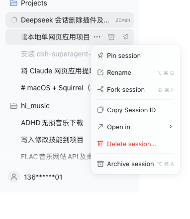
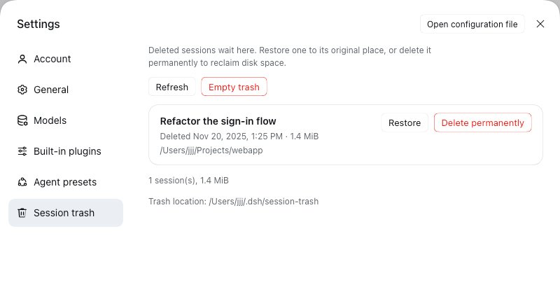

# Session trash for DeepSeek Harness

[](LICENSE)
[](https://github.com/jjjhrl/dsh-session-trash/actions/workflows/ci.yml)
[](#requirements)
[](#requirements)

A [DeepSeek Harness](#requirements) plugin that **deletes a Session into a local, recoverable trash** instead of only archiving it. Long-lived workspaces accumulate hundreds of sessions; this plugin turns the missing "delete" into two clicks, with a real recycle bin behind it.

[中文说明](README.zh-CN.md)

<table>
  <tr>
    <td width="42%"></td>
    <td width="58%"></td>
  </tr>
  <tr>
    <td><sub>Session row menu → <b>Delete session…</b>, above the built-in Archive row.</sub></td>
    <td><sub>Settings › <b>Session trash</b>: restore a session or delete it permanently.</sub></td>
  </tr>
</table>

## Features

- **Delete session…** in the sidebar `…` menu of any Session. One confirmation, then the Session's stored log leaves the Session store and its row disappears from every open client.
- **Settings › Session trash** (`会话回收站` on a Chinese UI) lists what the trash holds — title, deletion time, size, original directory — with **Restore**, **Delete permanently**, and **Empty trash**. Confirmations and results stay inline on that page.
- **Restorable by construction.** A delete renames the session-owned directory; nothing is rewritten, so a restore returns byte-identical history to the same place.
- **`session_trash` tool** for the agent (`list`, `delete`, `restore`, `purge`), backed by the same Host operations the UI calls — an assistant can clean up on request and report exactly what it moved.
- **Refuses unsafe deletes.** A Session still loaded in the running Host is rejected with an explanation, because its writer would keep appending into the trashed file; so is anything whose storage is not a dedicated session directory or holds foreign files.
- **Localized** in English and Chinese, and follows the app's theme and language.

## Requirements

- DeepSeek Harness `>= 0.2.2-rc.1` with the **web** GUI (the plugin uses the Web carrier's authenticated `/api` routes).
- Node.js `>= 20` on the Host.
- A JSONL session-persistence backend (`@deepseek-ai/dsh-session-persistence-jsonl`), which the shipped profile mounts under `$DSH_HOME/sessions`.

## Installation

### From GitHub (recommended)

In the DSH web GUI open **插件** (**Plugins**) → **添加插件** (**Add plugin**) and paste the repository URL:

```text
https://github.com/jjjhrl/dsh-session-trash
```

Confirm, then reload the page. GitHub installs are pinned to the commit you installed; the plugin's page in **插件** offers an update when the repository moves on.

### Ask the agent

```text
Install the DSH plugin from https://github.com/jjjhrl/dsh-session-trash
```

The agent calls the plugin manager's `install_bundle` with that URL and reports the result.

### From a local clone (development)

```bash
git clone https://github.com/jjjhrl/dsh-session-trash.git
cd dsh-session-trash
```

Then install that absolute directory through **插件 → 添加插件**, or ask the agent to install `/absolute/path/to/dsh-session-trash`. A local install is a link: edit the files and toggle the plugin row off and on to reload the Host half; reload the page for the Client half.

## Usage

### Delete a session

1. Hover a Session row in the sidebar and open its `…` menu.
2. Choose **删除会话…** (**Delete session…**).
3. Confirm **移入回收站** (**Move to trash**).

The row disappears immediately in every open tab. The conversation is not deleted from disk yet — it is in the trash.

### Restore or purge

Open **设置** (**Settings**) → **会话回收站** (**Session trash**):

| Control | Effect |
|---|---|
| **恢复** / Restore | Moves the session back to its original directory. Reload the page to see it in the sidebar again, in its previous archive/pin state. |
| **彻底删除** / Delete permanently | Deletes that trash entry. Irreversible. |
| **清空回收站** / Empty trash | Deletes every trash entry. Irreversible. |
| **刷新** / Refresh | Re-reads the trash directory. |

### From the agent

```text
List the session trash.
Delete session "session-db0f39d1-41c4-491c-9740-ce244f3ed601" (it is archived and unused).
Restore trash entry 20261123-134016-session-bd51ec4c-1ee7-4e0f-a86a-a7c0abd4e2a1.
```

The `session_trash` tool also works standalone: `action: list | delete | restore | purge`, with `sessionId`, `entryId`, `all`, and an optional `title`.

## How it works

One Session owns one directory under the JSONL persistence root, normally:

```text
$DSH_HOME/sessions/--<project>--/<encoded session id>/
  session.v4.jsonl.zstd     # current log generation (vN naming)
  session.lock              # write-lease file, usually empty
```

A delete:

1. Resolves the Session through `ctx.sessionPersistence.stat(id)` and proves the artifact lives in the directory the backend derives from that id.
2. Refuses when the Session is loaded in this Host process or the directory holds anything but session artifacts.
3. Renames the directory to `$DSH_HOME/session-trash/<yyyyMMdd-HHmmss>-<session id>/data` and writes `meta.json` beside it:

```json
{
  "version": 1,
  "entryId": "20261123-134016-session-bd51ec4c-1ee7-4e0f-a86a-a7c0abd4e2a1",
  "sessionId": "session-bd51ec4c-1ee7-4e0f-a86a-a7c0abd4e2a1",
  "title": "将 Claude 网页应用提取到本地并工程化",
  "cwd": "/Users/jjj/Projects",
  "createdAt": 1793927997534,
  "deletedAt": 1795412416922,
  "sizeBytes": 1285714,
  "sessionDir": "/Users/jjj/.dsh/sessions/--Users-jjj-Projects--/session-bd51ec4c-…"
}
```

4. Emits the Host's `api-session/removed` event so connected clients drop the row without a reload.

Restore renames `data/` back to `meta.json → sessionDir` and removes the entry; purge deletes the entry directory. Cross-device moves fall back to copy-then-delete.

The trash directory deliberately lives **outside** the persistence root: the backend lists every project directory below that root as Sessions, so an in-place `trash/` folder would re-appear as a project full of "sessions".

### What is not moved

- **Archive and pin flags** in the workspace registry are kept, so a restored Session returns in its previous state (a deleted archived Session is not listed again just because the registry remembers its id).
- **Projection caches, text spills, and attachments** are derived or shared state; they are rebuilt or reused, not trashed with the Session.
- **Worktrees** that a Session created are not reclaimed by a delete.

## Safety and limitations

- **Deleting is destructive for the Session's history.** It stays recoverable only while its trash entry exists; **Delete permanently** / **Empty trash** cannot be undone.
- **A Session still loaded in the running Host cannot be deleted.** The Host keeps Sessions it has opened alive for the whole process, and their writer would keep appending events into the trashed file. The dialog explains this; restart DSH Web and delete again, or archive instead. Cold Sessions — everything the process never opened — delete fine.
- **Restore does not push the row into an open client.** Reload the page; the Session returns from persistence.
- **Unusual storage is refused, never guessed.** A Session whose storage is not a `<project>/<encoded id>/` directory, or whose directory holds files other than `session*.jsonl*` and `session.lock`, is left untouched with an explanation. This includes a directory mid format-migration.
- Windows: deletion works like any other directory operation. If a file is locked by another process, the operation reports the failure instead of forcing it.
- The plugin is not affiliated with DeepSeek; it is a community plugin built against the public DSH plugin API.

## Development

The bundle is plain ESM with no dependencies and no build step:

| File | Role |
|---|---|
| `index.js` | Host half: authenticated `/api/session-trash/{list,delete,restore,purge}` Fetch routes, the `session_trash` tool, and the `api-session/removed` announcement. |
| `client.js` | Browser half (`window.__ModuleLoader__.load`): the row-menu action, the delete dialog and toast in `shell.overlay`, and the `settings.section` trash page. |
| `cordis.patch.yml` | Inserts the `session-trash` Host row. |
| `locale/*.json` | Plugin manager display metadata (title, description) per language. |
| `icon.svg` | Plugin icon. |

```bash
npm run check   # node --check on both halves, manifest/locale/patch validation
```

`scripts/check.mjs` validates syntax, the manifest's `dsh` fields, locale metadata, the loader patch, and that both client dictionaries carry the same keys. CI runs it on every push and pull request.

After editing, toggle the plugin in **插件** to reload the Host half, and reload the page for the Client half.

## Contributing

Issues and pull requests are welcome — see [CONTRIBUTING.md](CONTRIBUTING.md) and the [Code of Conduct](CODE_OF_CONDUCT.md). Security-sensitive reports belong in [SECURITY.md](SECURITY.md), not the public issue tracker.

## License

[MIT](LICENSE) © 2026 jjjhrl
