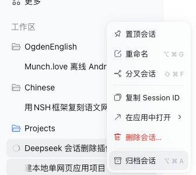
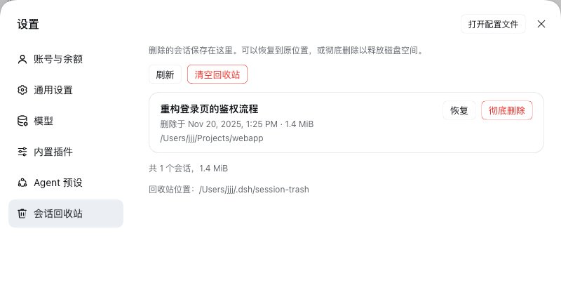

# DeepSeek Harness 会话回收站

[](LICENSE)
[](https://github.com/jjjhrl/dsh-session-trash/actions/workflows/ci.yml)
[](#requirements)

一个给 [DeepSeek Harness](#requirements) 用的插件：**把会话真正删除到本地回收站**，而不只是归档。工作区用久了会堆上几百个会话，这个插件把缺失的「删除」补成两次点击，背后是一个可恢复的回收站。

[English](README.md)

<table>
  <tr>
    <td width="42%"></td>
    <td width="58%"></td>
  </tr>
  <tr>
    <td><sub>会话行菜单 → <b>删除会话…</b>，位于内置「归档会话」上方。</sub></td>
    <td><sub>设置 › <b>会话回收站</b>：恢复，或彻底删除释放空间。</sub></td>
  </tr>
</table>

## 功能

- **删除会话…**：侧栏任一会话 `…` 菜单里，一次确认后该会话的存储日志离开会话库，所有打开的客户端立即移除这一行。
- **设置 › 会话回收站**：列出回收站内容（标题、删除时间、大小、原目录），可**恢复**、**彻底删除**、**清空回收站**；确认与结果都在这页行内完成。
- **按构造可恢复**：删除只是重命名会话专属目录，不重写任何字节，恢复后历史逐字节原样回到原位。
- **`session_trash` 工具**：给 Agent 用的 `list` / `delete` / `restore` / `purge`，与 UI 共用同一套 Host 实现，可以让 Agent 代劳整理并回报移动了什么。
- **拒绝不安全的删除**：仍被当前进程加载的会话会被拒绝并说明原因（它的写入会继续落进回收站）；存储布局不符或目录里混有非会话文件时也拒绝，而不是猜。
- **中英双语**，跟随应用的主题与语言。

## 环境要求

- DeepSeek Harness `>= 0.2.2-rc.1`，启用 **web** 版 GUI（插件使用 Web 传输层带鉴权的 `/api` 路由）。
- Host 端 Node.js `>= 20`。
- 使用 JSONL 会话持久化后端（`@deepseek-ai/dsh-session-persistence-jsonl`，默认 profile 已挂载到 `$DSH_HOME/sessions`）。

## 安装

### 从 GitHub 安装（推荐）

打开 DSH Web 的 **插件** → **添加插件**，粘贴仓库地址：

```text
https://github.com/jjjhrl/dsh-session-trash
```

确认后刷新页面。GitHub 安装会固定到当时那个提交；仓库有新提交后，插件页面的详情里会提供更新。

### 让 Agent 安装

```text
安装这个 DSH 插件：https://github.com/jjjhrl/dsh-session-trash
```

Agent 会用插件管理器的 `install_bundle` 以该地址安装并回报结果。

### 从本地克隆安装（开发）

```bash
git clone https://github.com/jjjhrl/dsh-session-trash.git
cd dsh-session-trash
```

然后用 **插件 → 添加插件** 安装该目录的**绝对路径**，或让 Agent 安装 `/绝对/路径/dsh-session-trash`。本地安装是链接安装：改完文件把插件行关一下再开即可重载 Host 半，客户端半刷新页面生效。

## 使用

### 删除会话

1. 在侧栏把鼠标移到某个会话行上，打开 `…` 菜单。
2. 选择 **删除会话…**。
3. 确认 **移入回收站**。

这一行会在所有打开的标签页里立即消失。此时磁盘上的记录还在——它在回收站里。

### 恢复或清除

**设置** → **会话回收站**：

| 操作 | 作用 |
|---|---|
| **恢复** | 把会话移回原目录。刷新页面后侧栏重新出现，并保持原来的归档/置顶状态。 |
| **彻底删除** | 删除该回收站条目，不可恢复。 |
| **清空回收站** | 删除回收站内全部条目，不可恢复。 |
| **刷新** | 重新读取回收站目录。 |

### 让 Agent 操作

```text
列一下会话回收站。
把 session-db0f39d1-41c4-491c-9740-ce244f3ed601 删掉（它已归档、不再使用）。
恢复回收站条目 20261123-134016-session-bd51ec4c-1ee7-4e0f-a86a-a7c0abd4e2a1。
```

`session_trash` 工具也可以单独调用：`action: list | delete | restore | purge`，配合 `sessionId`、`entryId`、`all` 和可选的 `title`。

## 工作原理

一个会话在 JSONL 持久化根下对应一个会话专属目录，通常是：

```text
$DSH_HOME/sessions/--<项目>--/<编码后的会话 id>/
  session.v4.jsonl.zstd     # 当前日志代际（vN 命名）
  session.lock              # 写租约文件，通常为空
```

删除时：

1. 通过 `ctx.sessionPersistence.stat(id)` 解析会话，并校验日志确实位于后端由该 id 推导出的目录里；
2. 若会话仍被本进程加载，或目录里混有非会话文件，直接拒绝；
3. 把目录重命名为 `$DSH_HOME/session-trash/<yyyyMMdd-HHmmss>-<会话 id>/data`，并在旁边写 `meta.json`（原目录、标题、cwd、创建/删除时间、大小）；
4. 发出 Host 的 `api-session/removed` 事件，已连接的客户端无需刷新即可移除该行。

恢复是把 `data/` 重命名回 `meta.json → sessionDir` 并删掉条目；彻底删除是删除条目目录。跨设备时自动退化为「复制 + 删除」。

回收站**刻意放在持久化根之外**：后端会把根下每个项目目录都当成会话来列，若把 `trash/` 放在里面，它会被重新当成一个装满「会话」的项目列出来。

### 不会一起移动的东西

- **归档 / 置顶标记**保留在工作区注册表里，所以恢复后会话回到原状态（已归档会话被删除后，也不会因为注册表还记得它的 id 而重新出现）。
- **投影缓存、文本 spill、附件**属于派生或共享状态，不随会话进回收站。
- 会话创建的 **worktree** 不会被删除回收。

## 安全性与限制

- **删除对会话历史是破坏性的**：只有回收站条目还在时才可恢复；**彻底删除**与**清空回收站**不可撤销。
- **仍被 Host 进程加载的会话不能删**：Host 会把打开过的会话保留在进程内，它的写句柄会继续把事件写进回收站里的文件。对话框会说明这一点——重启 DSH Web 后再删，或者改用归档。冷会话（本进程没打开过的）都能正常删除。
- **恢复不会主动把该行插回已打开的页面**，刷新页面即可。
- **不常见的存储布局一律拒绝**：不是 `<项目>/<编码 id>/` 结构、或目录里有 `session*.jsonl*` 与 `session.lock` 之外的文件（包括正处于格式迁移的目录），都会原样保留并说明原因。
- Windows 上按普通目录操作处理；若文件被其他进程占用，会报告失败而不是强删。
- 本插件与 DeepSeek 官方无关，是基于公开 DSH 插件 API 的社区插件。

## 开发

整个 bundle 是零依赖、无构建步骤的 ESM：

| 文件 | 作用 |
|---|---|
| `index.js` | Host 半：带鉴权的 `/api/session-trash/{list,delete,restore,purge}` Fetch 路由、`session_trash` 工具、`api-session/removed` 通知。 |
| `client.js` | 浏览器半（`window.__ModuleLoader__.load`）：行菜单项、`shell.overlay` 里的删除确认框与提示、`settings.section` 的回收站页。 |
| `cordis.patch.yml` | 插入 `session-trash` Host 行。 |
| `locale/*.json` | 插件管理器展示用的标题与描述。 |
| `icon.svg` | 插件图标。 |

```bash
npm run check   # 两个半边的语法检查 + 清单/文案/patch 校验
```

`scripts/check.mjs` 校验语法、清单里的 `dsh` 字段、locale 元数据、loader patch，以及中英两份客户端词条键一致。CI 在每次 push 和 PR 上运行。

改完文件后，在 **插件** 里把该插件关一下再开以重载 Host 半；客户端半刷新页面即可。

## 参与贡献

欢迎 issue 和 PR——见 [CONTRIBUTING.md](CONTRIBUTING.md) 与[行为准则](CODE_OF_CONDUCT.md)。安全问题请按 [SECURITY.md](SECURITY.md) 私下报告，不要开公开 issue。

## 许可

[MIT](LICENSE) © 2026 jjjhrl
